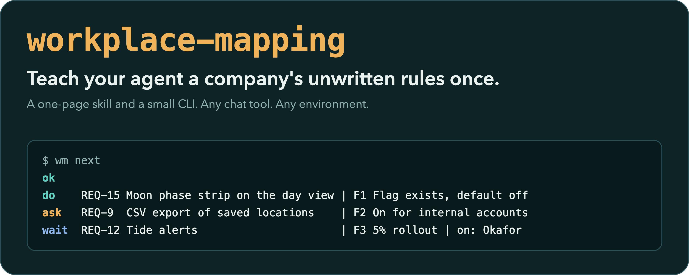
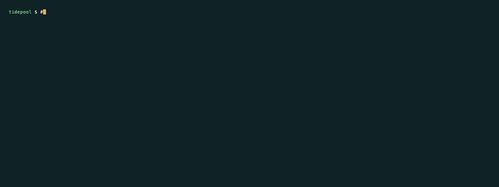
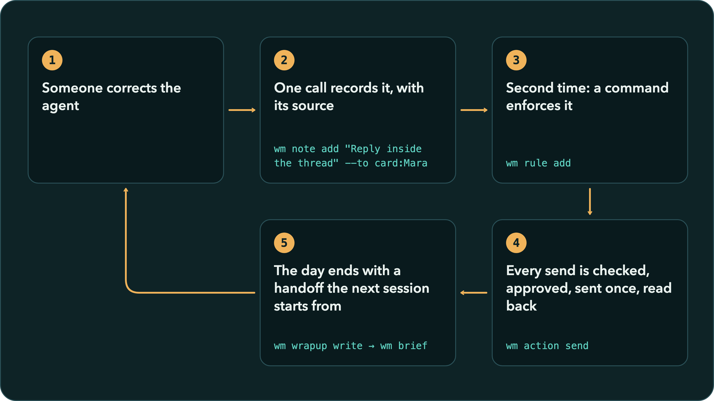
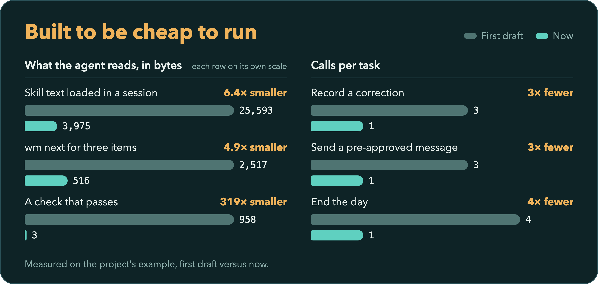

# workplace-mapping

[繁體中文](README.zh-TW.md) · [65-second overview video](docs/media/overview.mp4)

A method, a one-page skill and a small command-line tool for AI coding agents that do real work inside a company:
learn the company's unwritten rules once, keep them where the next session will find them, and let a command stop
the mistakes you were already corrected for.

It is built for an agent (Claude Code, Codex, or anything that can run a shell) that replies to colleagues, moves
tickets and ships changes for you. Every session starts from zero, so without a system you repeat the same context
every day: who tests what, who must be mentioned, what "done" means here.

It works at any company because it knows nothing about any of them. The chat tool (Slack, Teams, Telegram, DingTalk,
Lark, WeCom, or one built in-house) and the environment (your own machine, a stack of VPNs, a remote desktop, a
ticket queue in front of production) are things you **register as commands**. After that the agent uses the same
few verbs everywhere.

## What you get

| Part | What it is |
| --- | --- |
| `skills/workplace-mapping/` | A one-page skill: what to run and when. Six reference files are read only when a task needs them. Also in [Traditional Chinese](skills/zh-TW/workplace-mapping/SKILL.md). |
| `wm` | A Python CLI, standard library only. It reads and writes the project's records, says what to do next, and gates everything that sends or changes something. Reference: [docs/cli.md](docs/cli.md). |
| Templates | `wm init` creates a blank project in English or Traditional Chinese. |
| `examples/tidepool/` | An invented company, filled in, with stand-in tools, that every command runs against offline. |
| Hooks | Optional, Claude Code only: print the handoff when a session starts, keep a session open until a started wrap-up passes, block a chat message that breaks a rule. |

## How a day goes





```sh
wm brief                      # where yesterday stopped, what is due
wm next                       # what can be done now, what needs you, what is waiting on whom
wm run tickets.mine           # read a company system through a command you registered

# someone corrects the agent: one call records it, with its source, on that person's card
wm note add "Reply inside the thread" --who Mara --src "#4379" --to card:Mara
# the second time, it becomes a rule that a command enforces
wm rule add --id release-mentions --message "A release notice must @ the requester." --channels release --require-mention --src "#4407"

# sending: checked against the rules, approved by you (or by a standing approval), run once, read back
wm action send --kind chat --target release --to Ilse --verified "export ran on staging and production" < draft
wm action approve A-20260312-02 --by "yes, send it" --run

wm wrapup write --start "REQ-15: create the flag, default off"    # writes the handoff and checks it
```

## Built to be cheap to run

An agent pays for every character it reads and every call it makes, so:



| | First draft of this project | Now |
| --- | --- | --- |
| Skill text loaded in a work session | 25.6 KB | 4.0 KB (the rest on demand) |
| `wm next` for three items | 2,517 characters of JSON | 516 characters of text |
| A check that passes | 958 characters | `ok` |
| Recording a correction where it will be read | 3 calls, one of them a hand edit | 1 call |
| Sending a pre-approved kind of message | 3 calls | 1 call |
| Ending the day | 4 calls and a hand-written handoff | 1 call |

The agent does not open the people cards, the process tables or the ledgers. `wm sm F2` prints one row of a process
table; `wm card Mara` prints one card; every kind of record has a command that writes one line. `--json` gives the
full result when a script needs it.

It also asks you less. An approval is asked for once, with everything in one message. When you say a kind of action
no longer needs your yes, that becomes a standing approval with your words as its source.

## What it will not let through

- **A message that breaks a recorded rule.** Rules are regular expressions, required mentions, length limits,
  required receipts, or any check command of your own.
- **A completion claim without proof.** Proof the agent only asserts always goes to you first. Proof produced by a
  registered command (`wm receipt add --by-cmd`) can pass on its own.
- **A second send.** An action runs once. If the outcome is unclear it is marked unknown and nothing resends it.
- **"Sent" passing for "delivered".** A send counts as verified only when a read-back finds the message's id.
- **An unfinished day.** The wrap-up fails on unfiled notes, unknown actions, stale items and unlisted commits.
- **Silence read as "nothing".** What could not be read is reported as `unverified`, with a distinct exit code.

## Quick start

Requires Python 3.11 or later.

```sh
git clone https://gitlab.com/aa22396584/workplace-mapping.git && cd workplace-mapping
pip install .            # or run bin/wm straight from the checkout

# install the skill for your agent (the path shown is Claude Code's)
mkdir -p ~/.claude/skills && cp -R skills/workplace-mapping ~/.claude/skills/

# in your work project
cd ~/work/acme-project
wm init --name acme --lang en
echo ".wm/" >> .gitignore
wm doctor
```

Then try the example, which runs offline:

```sh
cd examples/tidepool
export WM_TEST_CLOCK=1 NOW=2026-03-12T18:30:00+00:00   # the example is frozen in time
wm --now $NOW next
wm catalog
echo "ack, on it" | wm --now $NOW action send --kind chat --target on-call --to Okafor
```

To plug in your own chat tool or environment, see [docs/adapters.md](docs/adapters.md).

## Before you use this at work

- **Your employer's rules come first.** If your company restricts outside AI tools, or what may leave its
  environment, that decides whether and how you use this. The method assumes you are allowed to use an agent for
  the work in question.
- **Company facts stay in the company project.** The skill and the tool hold no company data, and `wm lint` can
  check that your shared skills contain none (`lint.private_terms`). Do not publish a filled-in project.
- **`wm` only runs commands you registered.** It has no connector of its own. A command that writes or sends runs
  once, after a recorded approval, and its outcome is logged.

## What is not included

- Connectors for chat, ticketing or identity systems. They differ at every company; you register your own as
  commands.
- An MCP server. Any agent with a shell calls `wm` directly, which costs fewer tokens than tool schemas. Wrap it
  in MCP only for a client that has no shell.
- A credential store. Use your password manager.
- Commit-identity or data-egress guards. Write them for your company's rules, following
  `references/commands.md` in the skill.

## Development

```sh
python3 -m unittest discover -s tests
```

## Where this lives

The canonical repository, issues and releases are on GitLab: <https://gitlab.com/aa22396584/workplace-mapping>. Any copy elsewhere is a
read-only mirror.

## License

MIT. See [LICENSE](LICENSE).
