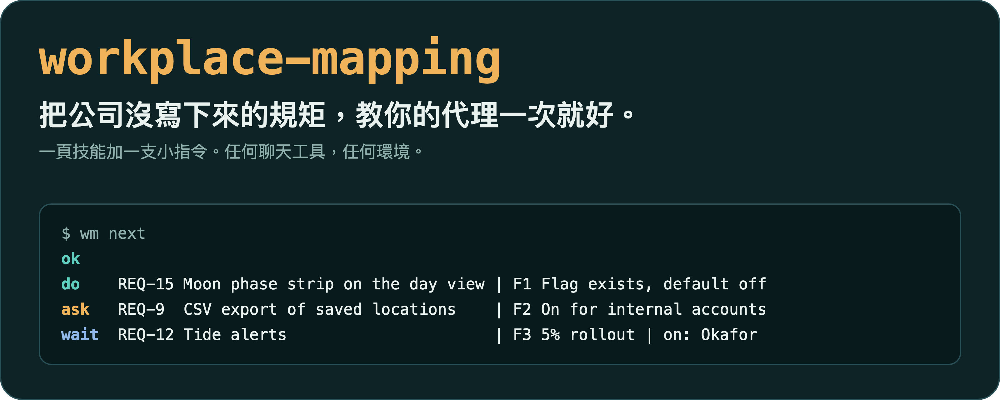
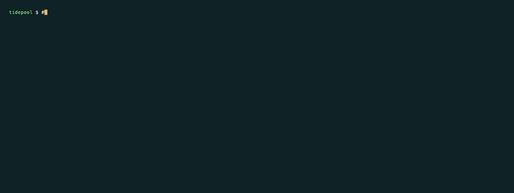
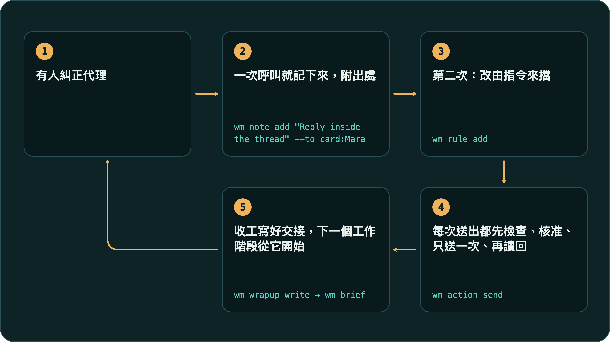
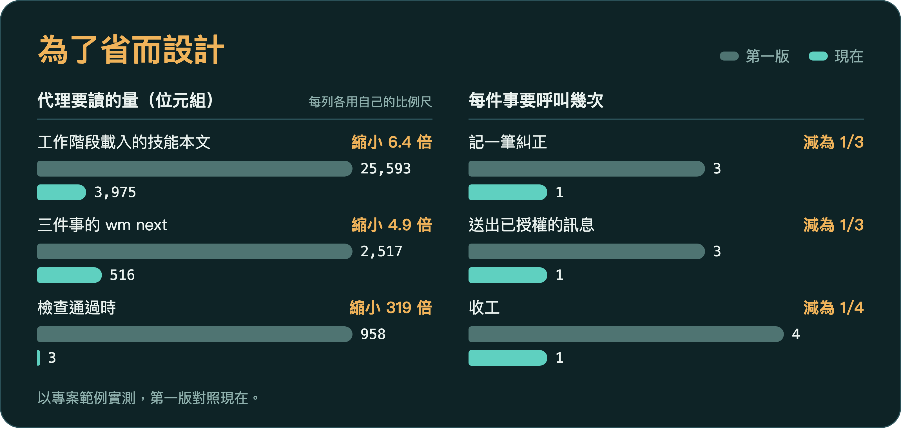

# workplace-mapping

[English](README.md) · [65 秒介紹影片](docs/media/overview.mp4)

給在公司裡替你做事的 AI 代理用的一套方法、一頁技能和一支小指令：把公司沒寫下來的規矩學一次，放在下一個工作階段找得到的地方，再讓指令擋下你已經被糾正過的錯。

適用的情況是：代理（Claude Code、Codex，或任何能跑 shell 的代理）替你回同事訊息、推工單、發版。每個工作階段都從零開始，沒有一套做法的話，你每天都要重講同樣的背景：誰負責測、要 @ 誰、這裡的「完成」是什麼意思。

它在任何公司都能用，因為它不認識任何一家公司。聊天工具（Slack、Teams、Telegram、釘釘、飛書、企業微信，或公司自研的）和環境（自己的機器、一層層 VPN、遠端桌面、擋在正式環境前面的工單佇列）都由你**登記成指令**。之後代理在哪裡都用同樣幾個動詞。

## 內容

| 部分 | 是什麼 |
| --- | --- |
| `skills/zh-TW/workplace-mapping/` | 一頁技能：什麼時候跑什麼。另有六個參考檔，需要時才讀。[英文版](skills/workplace-mapping/SKILL.md)內容相同。 |
| `wm` | Python 指令，只用標準庫。讀寫專案的各種紀錄、回答接下來做什麼、替所有會送出或改動東西的動作把關。說明見 [docs/cli.md](docs/cli.md)（英文）。 |
| 範本 | `wm init` 建立空白專案，有英文與繁體中文兩種。 |
| `examples/tidepool/` | 一家虛構公司的填好範例，附替身工具，每個指令都能離線對著它跑。 |
| Hook | 選用，只適用 Claude Code：開工自動印交接、收工檢查沒過時不讓工作階段結束、擋下違反規則的訊息。 |

## 一天怎麼過





```sh
wm brief                      # 昨天停在哪、什麼快到期
wm next                       # 現在能做什麼、什麼要你點頭、什麼在等誰
wm run tickets.mine           # 透過你登記的指令讀公司的系統

# 有人糾正代理：一次呼叫就記下來，帶出處，寫在那個人的卡上
wm note add "回覆要回在串裡" --who Mara --src "#4379" --to card:Mara
# 第二次再犯，就升級成由指令來擋的規則
wm rule add --id release-mentions --message "發版通知要 @ 提需求的人。" --channels release --require-mention --src "#4407"

# 送出：先對過規則，由你核准（或你給過的常態授權），只執行一次，再讀回
wm action send --kind chat --target release --to Ilse --verified "匯出在測試與正式環境都跑過" < 草稿
wm action approve A-20260312-02 --by "好，送" --run

wm wrapup write --start "REQ-15：建立開關，預設關"    # 寫好交接並檢查
```

## 為了省而設計

代理讀的每個字、做的每次呼叫都要算錢，所以：



| | 這個專案的第一版 | 現在 |
| --- | --- | --- |
| 工作階段載入的技能本文 | 22.8 KB | 3.7 KB（其餘需要才讀） |
| 三件事的 `wm next` | 2,517 字元的 JSON | 516 字元的文字 |
| 檢查通過時 | 958 字元 | `ok` |
| 把一筆糾正記到會被讀到的地方 | 3 次呼叫，其中一次是手動改檔 | 1 次呼叫 |
| 送出已經授權過的那類訊息 | 3 次呼叫 | 1 次呼叫 |
| 收工 | 4 次呼叫加手寫交接 | 1 次呼叫 |

代理不用開人卡、流程表或帳本。`wm sm F2` 印流程表的一列，`wm card Mara` 印一張卡，每種紀錄都有一條只寫一行的指令。腳本需要完整結果時加 `--json`。

它也比較少問你。要你點頭的事只問一次，全部放在同一則訊息裡。你說某一類動作以後不用問，那就變成一條常態授權，來源寫你的原話。

## 它不會放行的

- **違反已記錄規則的訊息。**規則可以是正則、必須提及誰、長度上限、必須附收據，或你自己的任何檢查指令。
- **沒有證據的「完成」。**代理自己說驗過的證據，一定先給你看。由登記過的指令產生的證據（`wm receipt add --by-cmd`）才能直接放行。
- **重複送出。**一個動作只執行一次。結果不明就標成 unknown，不會有東西去重送。
- **把「送出」當成「送達」。**讀回時找到那則訊息的編號，才算驗證過。
- **沒收尾的一天。**有沒歸檔的筆記、結果不明的動作、過期的狀態、沒列出的提交，收工檢查就不會過。
- **把沒讀到當成沒有。**讀不到的東西回報為 `unverified`，結束碼也不同。

## 開始用

需要 Python 3.11 以上。

```sh
git clone https://gitlab.com/aa22396584/workplace-mapping.git && cd workplace-mapping
pip install .            # 或直接用 bin/wm

# 把技能裝給你的代理（下面是 Claude Code 的路徑）
mkdir -p ~/.claude/skills && cp -R skills/zh-TW/workplace-mapping ~/.claude/skills/

# 在你的工作專案裡
cd ~/work/acme-project
wm init --name acme --lang zh-TW
echo ".wm/" >> .gitignore
wm doctor
```

接著試範例，可以離線跑：

```sh
cd examples/tidepool
export WM_TEST_CLOCK=1 NOW=2026-03-12T18:30:00+00:00   # the example is frozen in time
wm --now $NOW next
wm catalog
echo "ack, on it" | wm --now $NOW action send --kind chat --target on-call --to Okafor
```

要接上你自己的聊天工具或環境，見 [docs/adapters.md](docs/adapters.md)（英文）。

## 在工作上用之前

- **雇主的規定排第一。**公司限制外部 AI 工具、或限制什麼東西能離開公司環境時，由那些規定決定你能不能用、怎麼用。這套方法的前提是：你被允許用代理做這份工作。
- **公司的事實留在公司專案裡。**技能與工具不含任何公司資料，`wm lint` 可以檢查你的共用技能裡沒有混進去（`lint.private_terms`）。不要公開一份填好的專案。
- **`wm` 只執行你登記過的指令。**它自己沒有任何連接器。會寫入或送出的指令要有核准紀錄才執行，只執行一次，結果會記下來。

## 沒有包含的

- 聊天、工單、帳號系統的連接器。每家公司都不一樣，你把自己的登記成指令。
- MCP 伺服器。有 shell 的代理直接呼叫 `wm`，比載入工具定義省 token。只有沒有 shell 的客戶端才需要包一層。
- 憑證庫。請用你的密碼管理器。
- 提交身分或資料外流的守門。照你公司的規定自己寫，做法見技能的 `references/commands.md`。

## 開發

```sh
python3 -m unittest discover -s tests
```

## 這個專案在哪

正本、議題與發行版都在 GitLab：<https://gitlab.com/aa22396584/workplace-mapping>。其他地方的副本是唯讀鏡像。

## 授權

MIT，見 [LICENSE](LICENSE)。
